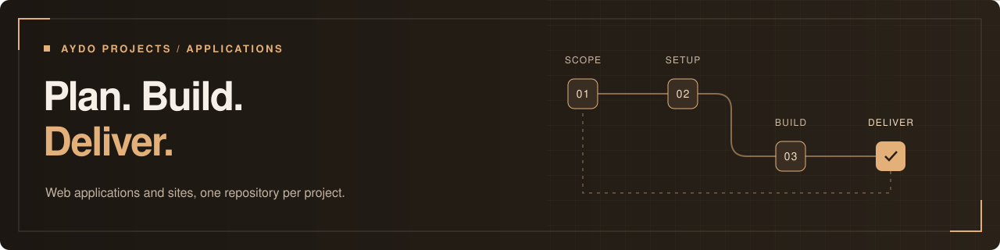
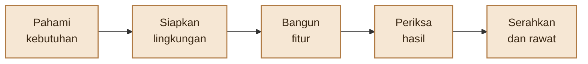

# AYDO Projects

**Aplikasi web dan situs, dikerjakan satu repository per proyek.**

AYDO Projects menyimpan proyek aplikasi dan situs web pribadi, dari kebutuhan awal sampai hasil yang siap digunakan. Setiap proyek berjalan di lingkungan pengembangan Docker yang sama, sehingga cara menyiapkan, menjalankan, dan melanjutkan pekerjaan konsisten dari satu proyek ke proyek berikutnya.

[Pendekatan](#pendekatan) · [Alur kerja](#alur-kerja) · [Penamaan](#penamaan) · [Prinsip](#prinsip) · [Kontak](#kontak)

## Pendekatan

Setiap proyek memiliki repository sendiri. Situs yang dibangun dari template yang sama disimpan sebagai branch dari repository template tersebut, sehingga pembaruan template dapat diteruskan ke setiap situs.

Lingkungan pengembangan disiapkan dengan template Docker dari **AYDO Tools**. Kode aplikasi berada di repository proyek, sedangkan konfigurasi lingkungan tetap di luar aplikasi.

## Alur kerja

Kedalaman perencanaan dan pemeriksaan disesuaikan dengan ukuran serta dampak perubahan.

## Penamaan

Nama repository diawali prefix yang menunjukkan stack proyek.

| Prefix | Stack |
| :--- | :--- |
| `lfm_` | Laravel dengan Filament |
| `lrv_` | Laravel tanpa Filament |
| `wcms_` | Winter CMS |
| `web_` | Situs statis atau non-Laravel |

Situs yang dibangun dari template memakai singkatan template sebagai prefix tambahan, misalnya `wcms_wi_` untuk situs dari template undangan pernikahan. Proyek yang berpindah stack dibuat sebagai repository baru, bukan mengganti nama repository lama. Proyek lama yang tidak lagi dikembangkan di-archive tanpa mengubah namanya.

Proyek freelance dan pesanan klien disimpan terpisah di **[AYDO Works](https://github.com/AYDO-Works)** dengan aturan penamaan yang sama.

## Prinsip

- **Satu proyek, satu repository.** Riwayat setiap proyek terpisah dan mudah ditelusuri.
- **Lingkungan yang dapat dibuat ulang.** Setiap proyek dapat dijalankan kembali dari repository dan template Docker yang sama.
- **Perubahan tercatat.** Kode yang berjalan adalah kode yang di-commit.
- **Nama menjelaskan isi.** Prefix menunjukkan stack sebelum repository dibuka.

## Kontak

Dikelola oleh **Adi Yudhanegara**.

| Kanal | Alamat |
| :--- | :--- |
| Email | [adi.yudhanegaradona@gmail.com](mailto:adi.yudhanegaradona@gmail.com) |
| WhatsApp | [+62 896-5104-6251](https://wa.me/6289651046251) |
| LinkedIn | [linkedin.com/in/adiyudhanegara](https://www.linkedin.com/in/adiyudhanegara) |
| Instagram | [@adiyudhanegara](https://www.instagram.com/adiyudhanegara) |
| Facebook | [facebook.com/adiyudhanegara](https://www.facebook.com/adiyudhanegara) |

---

AYDO Projects · Plan. Build. Deliver.
